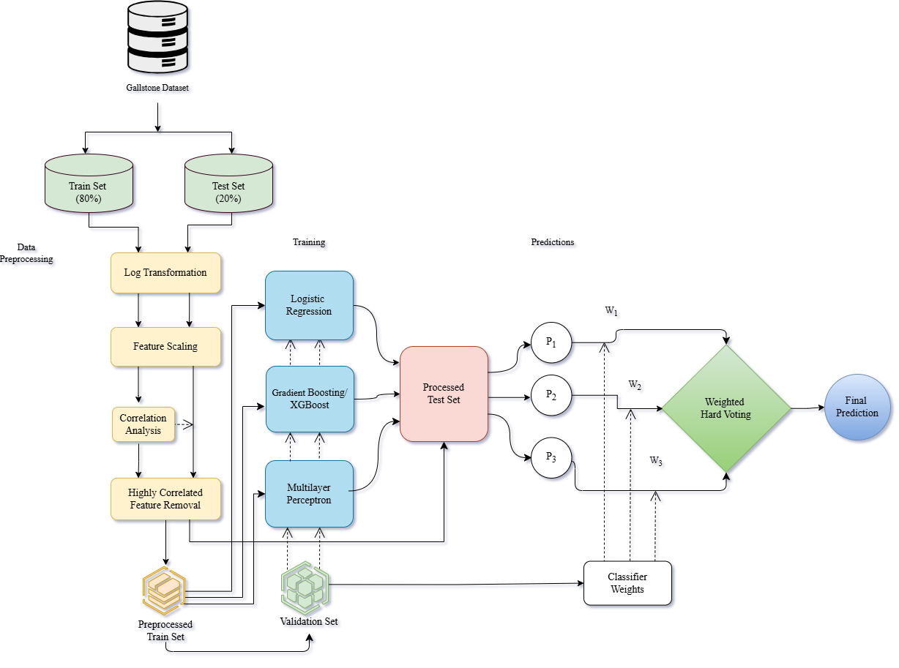
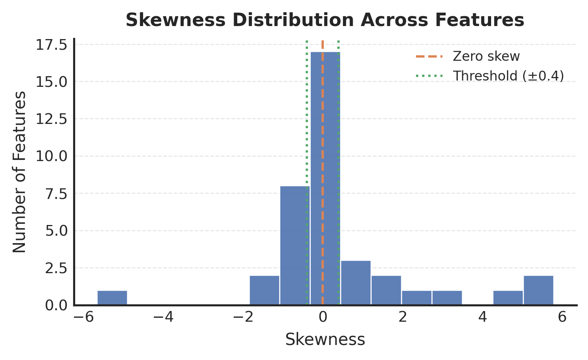
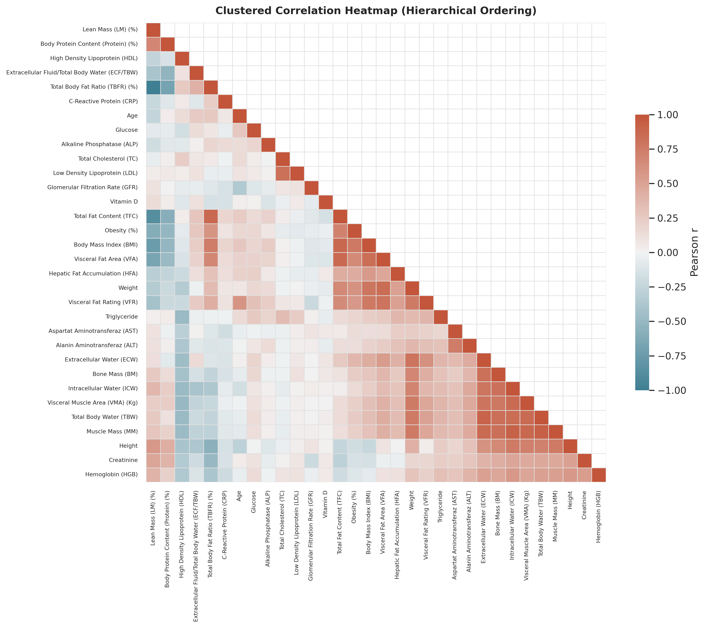
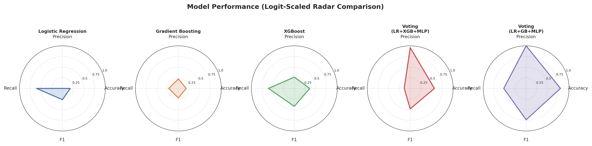
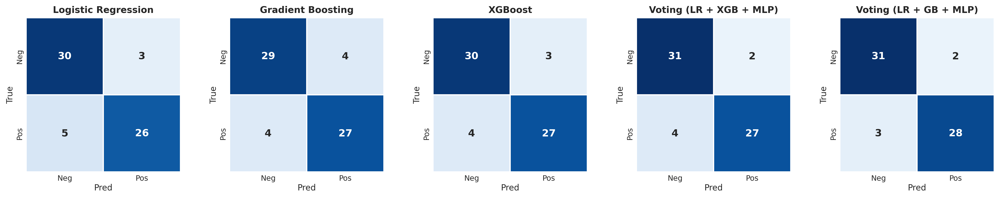
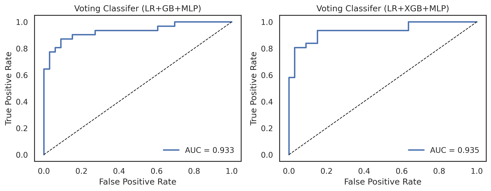
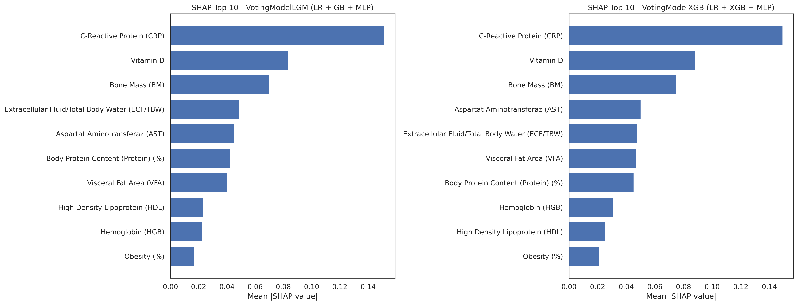

# An Explainable Ensemble Learning Framework for Gallstone Disease Prediction Using Structured Clinical Data

A leakage-free, correlation-aware ensemble learning framework for non-invasive gallstone disease prediction from structured clinical and bioimpedance data. A grid-search-weighted hard-voting ensemble of Logistic Regression, Gradient Boosting/XGBoost and a Multilayer Perceptron (MLP) is compared against nine baseline classifiers, and SHAP is used to explain which clinical features drive the predictions.

## Features

- Leakage-free pipeline: the train/test split is done first, and all preprocessing parameters are learned from the training set only
- Skewness detection with log transformation (`|skew| > 0.4`)
- Z-score feature scaling
- Pearson correlation filtering (`|r| > 0.9`), reducing 38 features to 35
- Nine baseline classifiers: LR, DT, RF, GB, AdaBoost, SVM, KNN, Naive Bayes, XGBoost (plus MLP)
- Two proposed weighted hard-voting ensembles: **LR + GB + MLP** and **LR + XGB + MLP**
- Ensemble weights optimized with 5-fold stratified cross-validation and grid search
- Evaluation with accuracy, precision, recall, F1-score, confusion matrices and ROC-AUC
- SHAP-based interpretation of both ensemble models
- Ablation study showing the contribution of each preprocessing step

## Tech Stack

- Language: Python 3
- Environment: Jupyter Notebook / Google Colab
- Libraries: scikit-learn, XGBoost, SHAP, Optuna, pandas, NumPy, SciPy, matplotlib, seaborn

## Dataset

The dataset contains medical records of **319 subjects** (161 and 158 in the two classes) collected at the Internal Medicine Outpatient Clinic of Ankara VM Medical Park Hospital between June 2022 and June 2023. Each subject has **38 features** across three categories:

- **Demographic:** age, sex, height, weight, BMI
- **Bioimpedance:** total, extracellular and intracellular body water, muscle mass, fat mass, protein, visceral fat area, hepatic fat
- **Laboratory:** glucose, total cholesterol, HDL, LDL, triglycerides, AST, ALT, ALP, creatinine, GFR, CRP, haemoglobin, Vitamin D

The dataset has no missing values and the two classes are almost perfectly balanced.

## Installation

### Prerequisites

- Python 3.8 or higher
- Jupyter Notebook or Google Colab

### Clone and install

```bash
git clone https://github.com/<your-username>/<your-repo-name>.git
cd <your-repo-name>
pip install numpy pandas scipy scikit-learn xgboost shap optuna matplotlib seaborn jupyter
```

## Project Structure

```text
<your-repo-name>/
|-- rerun_gallstone_updated.ipynb   # Full pipeline: preprocessing, training, evaluation, SHAP
|-- README.md
|-- images/
|   |-- methodology.png
|   |-- class_distribution.png
|   |-- skewness_distribution_accross_features.png
|   |-- clustered_correlation_heatmap.png
|   |-- model_performance_spider_plot.png
|   |-- confusion_matrices.png
|   |-- ROC_AUC_Curve.png
|   `-- top-10-shap-values.png
```

## Usage

1. Open `rerun_gallstone_updated.ipynb` in Jupyter Notebook or Google Colab.
2. Update the dataset path in the data-loading cell so it points to your copy of the gallstone dataset.
3. Run all cells in order.
4. The notebook performs preprocessing, trains the baseline and ensemble models, and produces the evaluation plots and SHAP analysis.

## Methodology

The dataset is split into training (80%, n = 255) and test (20%, n = 64) sets **before** any preprocessing. Log transformation, scaling and correlation filtering are fitted on the training set and then applied unchanged to the test set. Three complementary classifiers are then combined with a weighted hard-voting rule, where the weights are selected on a validation set.

<p align="center">
  
</p>

### Preprocessing

**Skewness detection.** Features with `|skewness| > 0.4` are log-transformed using `ln(x + 1)`.

<p align="center">
  
</p>

**Correlation filtering.** Highly correlated feature pairs (`|r| > 0.9`) are removed. This dropped Extracellular Water, Lean Mass and Muscle Mass, reducing the feature count from 38 to 35.

<p align="center">
  
</p>

### Ensemble Model

The final prediction is a weighted hard vote over three base classifiers:

```text
y_hat = argmax_c  sum_j ( w_j * 1[h_j(x) = c] )
```

The best weight configuration found by grid search (weights sum to 10) was `[w_LR, w_GB/XGB, w_MLP] = [2, 4, 4]`.

## Results

### Overall Performance (test set)

| Model | Accuracy | Precision | Recall | F1-Score |
|---|---|---|---|---|
| XGBoost | 0.8906 | 0.9000 | 0.8710 | 0.8852 |
| Gradient Boosting | 0.8750 | 0.8710 | 0.8710 | 0.8710 |
| Logistic Regression | 0.8750 | 0.8966 | 0.8387 | 0.8667 |
| Random Forest | 0.8438 | 0.8387 | 0.8387 | 0.8387 |
| MLP | 0.8438 | 0.8387 | 0.8387 | 0.8387 |
| AdaBoost | 0.7969 | 0.8214 | 0.7419 | 0.7797 |
| SVM | 0.7812 | 0.8400 | 0.6774 | 0.7500 |
| Decision Tree | 0.7500 | 0.7586 | 0.7097 | 0.7333 |
| KNN | 0.6406 | 0.7000 | 0.4516 | 0.5490 |
| Naive Bayes | 0.5781 | 1.0000 | 0.1290 | 0.2286 |
| Voting (LR + XGB + MLP) | 0.9062 | 0.9310 | 0.8710 | 0.9000 |
| **Voting (LR + GB + MLP)** | **0.9219** | **0.9333** | **0.9032** | **0.9180** |

<p align="center">
  
</p>

### Confusion Matrices

The LR + GB + MLP ensemble classified 59 of 64 test samples correctly, with 3 false negatives and 2 false positives.

<p align="center">
  
</p>

### ROC-AUC

The two voting ensembles reach an AUC of 0.933 (LR + GB + MLP) and 0.935 (LR + XGB + MLP).

<p align="center">
  
</p>

### SHAP Interpretability

SHAP analysis was run on both ensembles. C-Reactive Protein (CRP) is the most influential predictor in both models, followed by Vitamin D and Bone Mass. AST, ECF/TBW, Body Protein Content and Visceral Fat Area also contribute notably. The two models rank features very similarly, which supports the robustness of the framework.

<p align="center">
  
</p>

### Ablation Study

| Configuration | F1-Score |
|---|---|
| Raw features (no preprocessing) | 0.7719 |
| Scaling only | 0.7797 |
| Log transformation + scaling | 0.8710 |
| Log transformation + scaling + correlation filtering | 0.9180 |
| Full pipeline + optimized voting weights | 0.9254 |

### Comparison with Prior Work (same dataset)

| Study | Best Model | Accuracy | F1-Score |
|---|---|---|---|
| Esen et al. | Gradient Boosting | 0.85 | 0.86 |
| Indirani et al. | Stacking (RF + XGB -> LR) | 0.85 | 0.86 |
| **This study** | **Voting (LR + GB + MLP)** | **0.92** | **0.92** |

## Limitations

- The dataset has only 319 subjects from a single hospital, which may limit generalizability.
- A single fixed train/test split was used, so results may be sensitive to the split.
- Baseline classifiers used default hyperparameters.

## Future Enhancement

- External validation on larger, multi-center datasets
- Repeated cross-validation over multiple random seeds
- Systematic hyperparameter optimization

## License

This project is for academic and research purposes.
